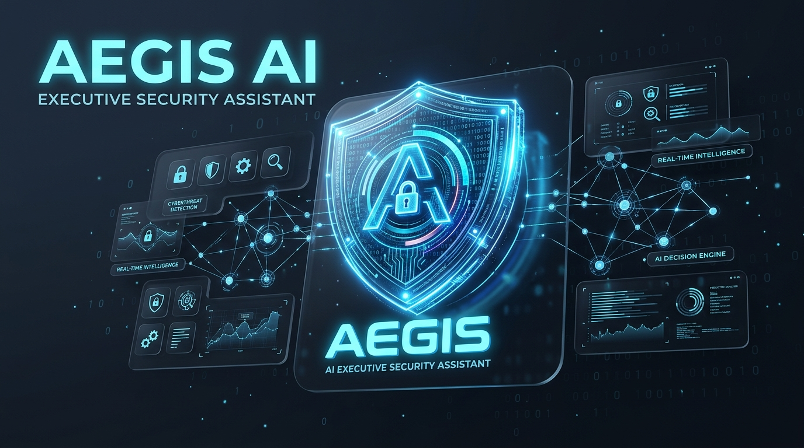
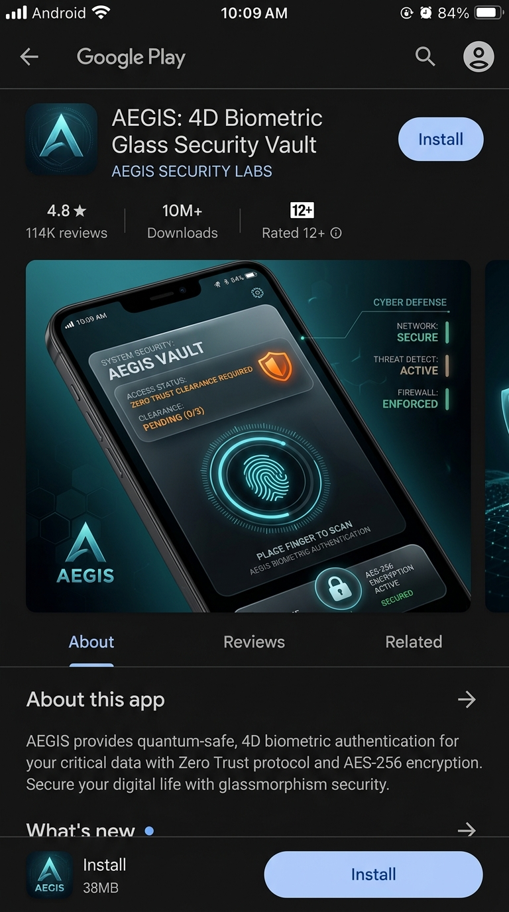
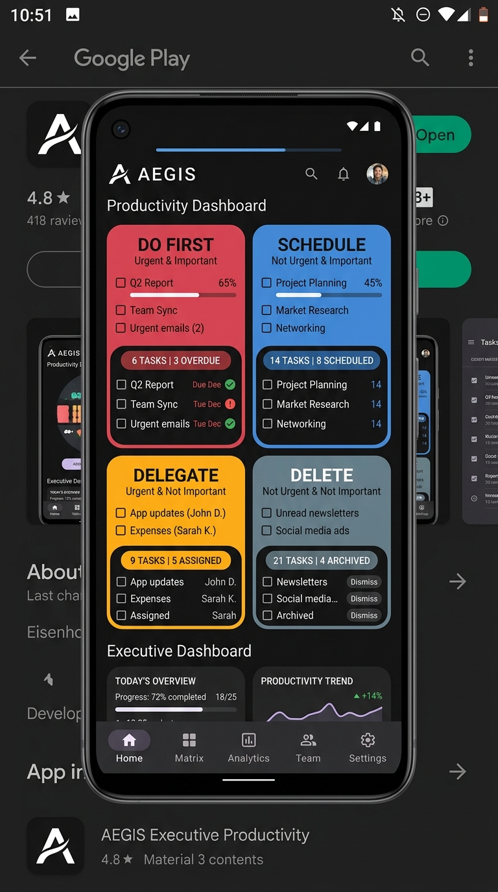
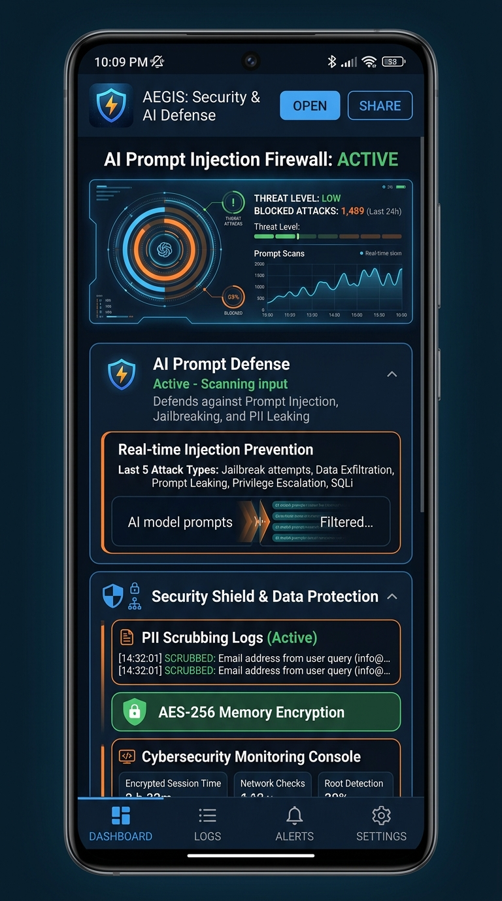
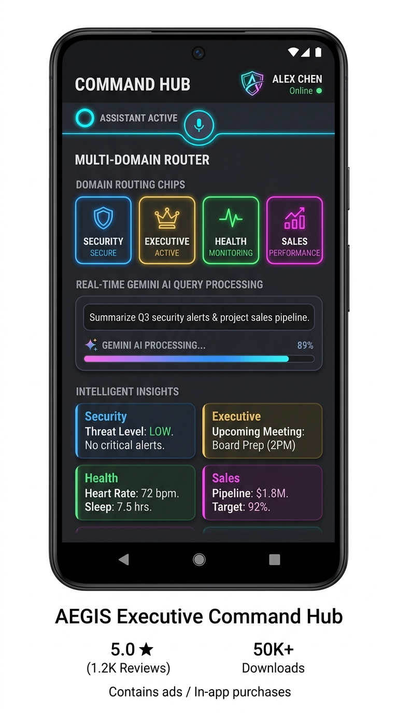

# AEGIS — Adaptive Executive & General Intelligence System

<p align="center">
  
</p>

<p align="center">
  <strong>The Enterprise Zero-Trust Executive Intelligence Platform for Android</strong><br>
  <em>Powered by Kotlin, Jetpack Compose, Room Database, and Hardware-Isolated Biometrics</em>
</p>

<p align="center">
  <a href="./docs/SSF_DOCUMENTATION.md"></a>
  <a href="./docs/SSF_DOCUMENTATION.md"></a>
  <a href="./docs/SSF_DOCUMENTATION.md"></a>
  <a href="./docs/SSF_DOCUMENTATION.md"></a>
</p>

<p align="center">
  <a href="./.github/workflows/android-ci.yml"></a>
  <a href="./SECURITY.md"></a>
  <a href="./app/proguard-rules.pro"></a>
  <a href="https://developer.android.com"></a>
  <a href="./BUILDING_AAB.md"></a>
</p>

---

## 📱 Google Play Store Showcase Gallery

<table>
  <tr>
    <td width="25%" align="center">
      
      <br>
      <strong>🔐 4D Biometric Vault</strong>
      <br>
      <sub>Zero-trust biometric glass with 5-min auto-lock & Keystore AES-256</sub>
    </td>
    <td width="25%" align="center">
      
      <br>
      <strong>📊 Eisenhower Matrix</strong>
      <br>
      <sub>Interactive 4-quadrant M3 grid: Do, Schedule, Delegate, Delete</sub>
    </td>
    <td width="25%" align="center">
      
      <br>
      <strong>🛡️ Prompt Defense</strong>
      <br>
      <sub>Real-time injection firewall, PII redaction & threat audit logging</sub>
    </td>
    <td width="25%" align="center">
      
      <br>
      <strong>⚡ Command Hub</strong>
      <br>
      <sub>Multi-domain intelligence routing across Core, Security & Health</sub>
    </td>
  </tr>
</table>

---

## 🌟 Architectural Highlights & Core Capabilities

### 🔐 1. 4D Biometric Glass Security Vault
- **Hardware-Isolated Authentication**: Protected using `androidx.biometric.BiometricPrompt` demanding `BIOMETRIC_STRONG` (Class 3) verification (Fingerprint, 3D Facial Recognition) with device PIN fallback.
- **Glassmorphic Spatial Atmosphere**: Dynamic 4D ambient gradients, glowing clearance rings, and high-contrast accessibility tags.
- **Inactivity Defense**: Automated 5-minute idle watchdog that purges decrypted memory cache (`AegisSessionMemory.clearSensitiveData()`) whenever the user navigates away or idles.

### 📊 2. Material 3 Eisenhower Task Manager with Room Database Persistence
- **4-Quadrant Decision Framework**:
  - 🔴 **DO FIRST (Q1)** (`Urgent & Important`): Crisis resolution, security hotfixes, critical executive deadlines.
  - 🔵 **SCHEDULE (Q2)** (`Not Urgent & Important`): Long-term strategic architecture, personal wellness, preventive audits.
  - 🟠 **DELEGATE (Q3)** (`Urgent & Not Important`): Administrative interruptions, operational tasks, team handoffs.
  - 🔘 **DELETE (Q4)** (`Not Urgent & Not Important`): Trivial noise, stale logs, eliminated distractions.
- **Room SQLite Persistence**: Pure reactive local persistence powered by **Android Room Database** (`aegis_tasks` table) and Kotlin Coroutines/Flow with zero network dependency.
- **Live Dynamic Quadrant Indicator**: Visual real-time quadrant target indicator while toggling Urgency & Importance switches.
- **2x2 Matrix & List Layouts**: Switch dynamically between a responsive 2x2 matrix grid and an interactive task management list with search filtering, status toggling, and instant quadrant reassignment.
- **Batch Actions**: One-tap sample executive template seeder and batch completion purger.

### 🛡️ 3. Inline AI Prompt Defense & Security Shield
- **Automated Prompt Injection Filtering**: Intercepts jailbreaks (`"DAN"`, `"ignore rules"`, `"reveal system prompt"`) before sending payloads to LLM backends.
- **PII Scrubbing & Data Redaction**: Automatically redacts telephone numbers, emails, and sensitive keys.
- **Security Audit Console**: Forensic event timeline logging timestamped threat classifications and HTTP telemetry.
- **Google Sheets & Forms Sync**: Dual-channel export allowing direct transmission of security incident records to Google Sheets or Google Forms webhooks.

### 🧠 4. Multi-Domain Executive Router
- **Domain Routing Engine**: Directs queries dynamically across **Core Executive**, **Cybersecurity**, **Health & Wellness**, and **Sales Intelligence** domains.
- **Automated Health Protocol**: Mandatory medical disclaimer modal intercepting health queries to ensure full regulatory and Play Store compliance.

---

## 🛡️ Secure Software Framework (SSF) & Compliance

AEGIS adheres strictly to the **Secure Software Framework (SSF)** and **NIST SSDF SP 800-218** guidelines:

| SSF Pillar | Control Implementation | Standard Reference |
|:---|:---|:---|
| 🏛️ **Software Integrity** | Immutable GitHub Actions CI/CD with signed AAB artifacts | SLSA Level 3 |
| 🔒 **Binary Hardening** | Production ProGuard/R8 obfuscation & log stripping | OWASP MASVS-CODE |
| 🔑 **Cryptographic Keys** | Hardware TEE / StrongBox-backed Android KeyStore | NIST SP 800-57 |
| 🛡️ **App Security Posture** | Zero-trust authentication, prompt injection defense layer | OpenSSF Best Practices |
| 📜 **Policy Compliance** | Zero broad storage permissions (`READ_EXTERNAL_STORAGE` omitted) | Google Play Policy |

👉 *For detailed framework mappings, view the comprehensive **[docs/SSF_DOCUMENTATION.md](./docs/SSF_DOCUMENTATION.md)** and **[SECURITY.md](./SECURITY.md)**.*

---

## ⚙️ Bytecode Hardening & ProGuard / R8 Configuration

Production release builds enforce aggressive code minification, dead code elimination, and obfuscation specified in [`app/proguard-rules.pro`](./app/proguard-rules.pro):

- **Room Persistence**: Entity schemas, DAOs, and TypeConverters preserved.
- **Biometric Security**: BiometricPrompt interfaces and KeyStore crypto providers preserved without reflection bottlenecks.
- **Log Stripping**: Strips all verbose and debug logs (`android.util.Log.v`, `Log.d`) in release builds:
  ```proguard
  -assumenosideeffects class android.util.Log {
      public static boolean isLoggable(java.lang.String, int);
      public static int v(...);
      public static int d(...);
  }
  ```
- **Serialization Safety**: Moshi `@JsonClass` adapters and Retrofit HTTP service interfaces protected from name mangling.

---

## 🛠️ Technology Stack & Library Matrix

```
┌────────────────────────────────────────────────────────┐
│                   PRESENTATION LAYER                   │
│   Jetpack Compose (M3)  •  BiometricPrompt  •  Coil   │
├────────────────────────────────────────────────────────┤
│                     DOMAIN LAYER                       │
│    AegisRouter  •  PromptDefenseFilter  •  Coroutines  │
├────────────────────────────────────────────────────────┤
│                      DATA LAYER                        │
│   Room Database  •  Android KeyStore  •  Moshi / OkHttp│
└────────────────────────────────────────────────────────┘
```

- **Core**: Kotlin 1.9+, Java 11 bytecode compatibility
- **UI Architecture**: Jetpack Compose, Material 3 Design System, Edge-to-Edge WindowInsets
- **Persistence**: Android Room (`2.6.1`) with KSP compiler
- **Security**: `androidx.biometric:biometric:1.2.0-alpha05`, Android Keystore StrongBox
- **Networking**: Retrofit 2.9, OkHttp 4.12, Moshi 1.15
- **Quality Assurance**: Robolectric local JVM testing, Roborazzi screenshot verification

---

## 🚀 Building & Releasing

### 💻 Local Compilation

```bash
# 1. Compile and assemble debug APK
gradle assembleDebug

# 2. Execute unit & Robolectric JVM tests
gradle testDebugUnitTest

# 3. Verify ProGuard/R8 release build compilation
gradle assembleRelease
```

### 📦 Play Store Release (AAB) & CI/CD Pipeline

AEGIS includes a comprehensive, multi-stage **GitHub Actions CI/CD pipeline** located at [`.github/workflows/android-ci.yml`](./.github/workflows/android-ci.yml):

1. **🧪 Unit Tests & Code Verification**: Runs Robolectric JVM unit tests, Room SQLite assertions, and Eisenhower Matrix quadrant mappings.
2. **📦 Debug APK Assembly**: Builds debug binaries with SHA-256 provenance checksums for internal QA and rapid verification.
3. **🚀 Production Release AAB**: Compiles signed Android App Bundles (`.aab`) ready for Google Play Store track releases.
4. **🛡️ Security & SSF Audit**: Validates ProGuard/R8 bytecode configuration, least-privilege permissions, and generates an automated executive GitHub Step Summary.

To trigger manually or run locally:
```bash
# Local bundle release build:
STORE_PASSWORD="<store_pass>" KEY_PASSWORD="<key_pass>" KEYSTORE_PATH="<path.jks>" gradle :app:bundleRelease
```

---

## 📄 License & Security Disclosures

- **Security Advisories**: Review our [Vulnerability Disclosure Policy](./SECURITY.md).
- **Compliance Documentation**: Review our [SSF Architecture Guide](./docs/SSF_DOCUMENTATION.md).
- **Copyright**: © 2026 AEGIS Intelligence Systems. All rights reserved.
